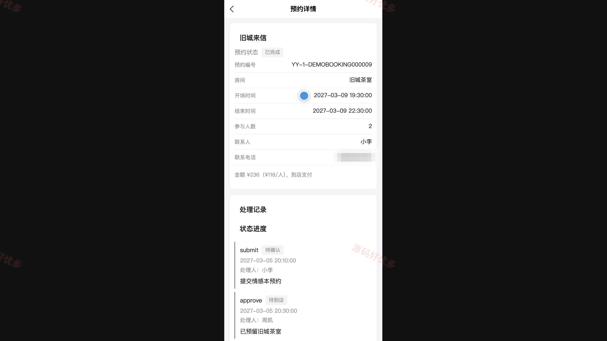
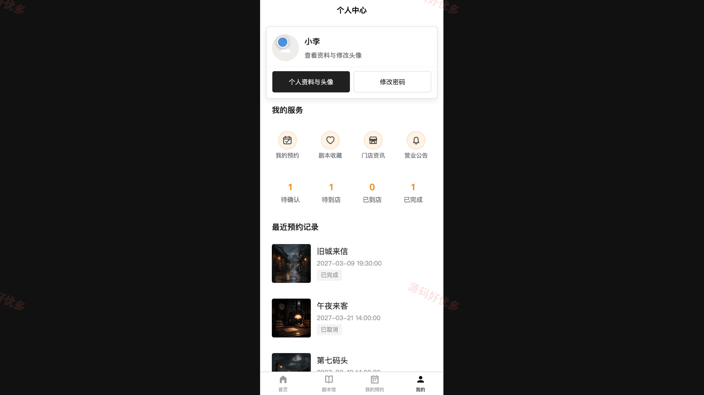
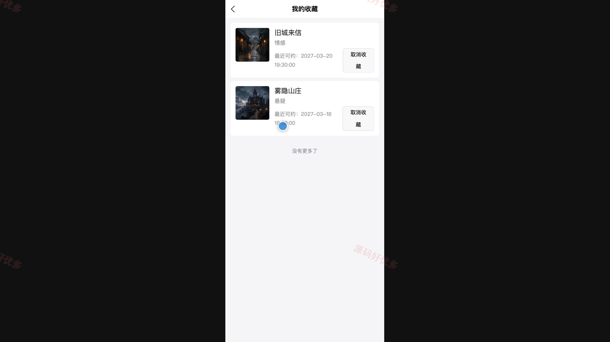
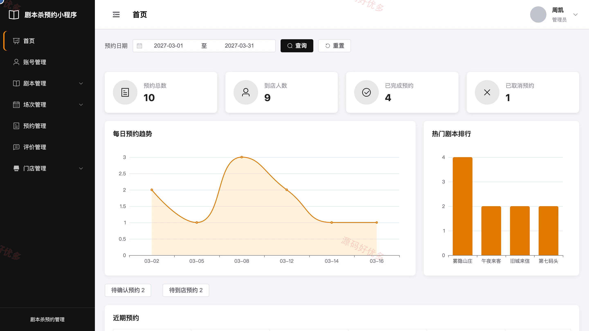
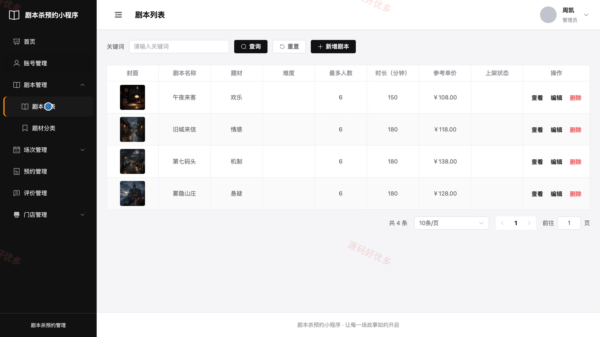
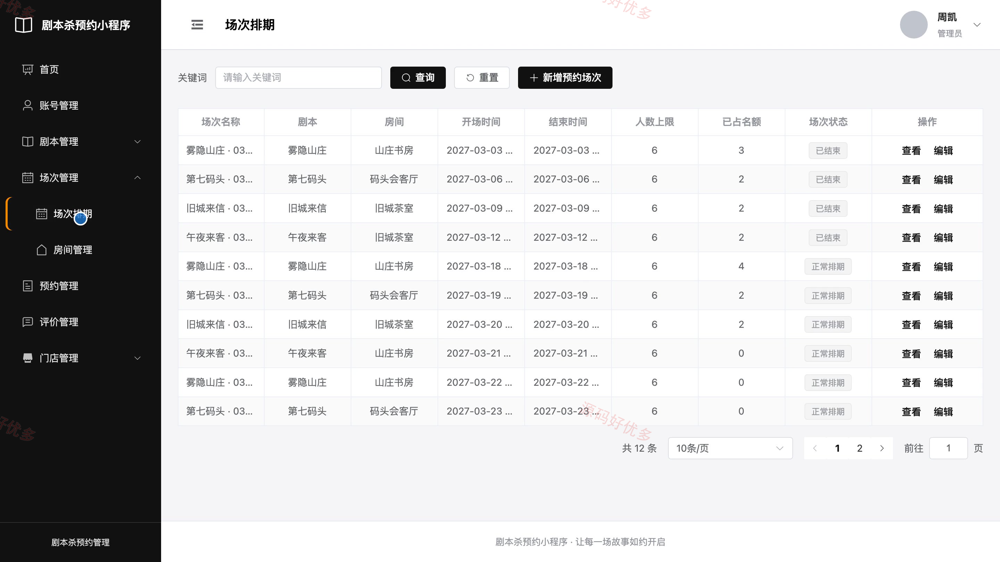

## 源码问题查看主页咨询

### 一、关键词
剧本杀预约、推理馆预约、桌游场次预订、沉浸式娱乐预约、线下活动预约

### 二、作品包含
源码+数据库+万字设计文档+PPT+全套环境和工具资源+本地部署教程

### 三、项目技术
前端技术： Html、Css、Js、Vue3.4、Element-Plus、uniapp
后端技术：Java、SpringBoot3.2.0、MyBatis-Plus

### 四、运行环境要求
开发工具：IDEA/eclipse + VSCODE + HBuilder X + 微信开发者工具

数据库：MySQL5.7+（共13张表）

数据库管理工具：Navicat10以上版本

环境配置软件： JDK17 + Maven3.6

前端Nodejs：20

浏览器：谷歌浏览器

### 五、项目介绍
项目编号：bs085B

本项目面向剧本杀门店的场次预约与履约管理。玩家可在小程序中筛选剧本、查看可预约场次、提交到店支付预约、收藏剧本并评价已完成体验；管理员在 PC 端维护剧本、分类、房间和场次，处理预约审核、到店核验、评价回复、门店公告及经营统计。系统对房间时间冲突、场次容量与预约状态进行联动校验，防止重复排期和超额预约。

角色：玩家、管理员

玩家功能：注册登录与个人资料、剧本筛选与详情查看、可预约场次查询、在线预约与状态跟踪、未到店预约取消、剧本收藏、已完成预约评价、门店资讯与公告查看。

管理员功能：玩家账号与启停管理、剧本与题材分类管理、房间与场次排期管理、预约审核与操作记录、到店核验与完成确认、场次取消与名额释放、评价回复、门店公告与经营统计。

### 六、运行截图

